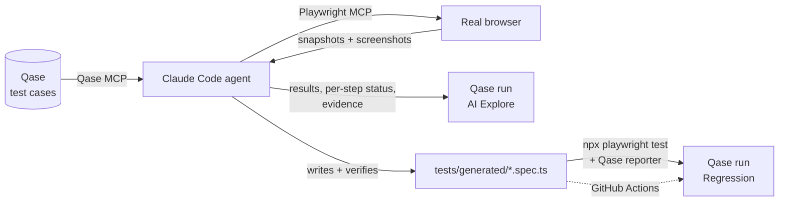

# Qase Hybrid Agent

**AI explores the test case once. Code runs it every time after.**

An AI agent (Claude Code) reads manual test cases from **Qase**, executes them in a real browser
through the **Playwright MCP**, records results and screenshot evidence back to Qase, and then
**writes a permanent Playwright spec for each case**. From that point on, regression runs are
plain Playwright: fast, deterministic, CI-friendly, with no AI in the loop.

Both sides talk to Qase through the **Model Context Protocol (MCP)**, so the agent needs no
custom integration code: one MCP server for test management, one for the browser.

---

## How it works



| Phase | Who runs it | Command | Output |
|---|---|---|---|
| **1. Seed** | Agent → Qase MCP | `/qase-seed` | Suite + test cases created in Qase |
| **2. Explore** | Agent → Playwright MCP | `/qase-explore suite:<id>` | Qase run with status and one screenshot per step |
| **3. Codify** | Agent | (part of `/qase-explore`) | One spec per case, run once to prove it reproduces the explore result |
| **4. Regression** | Playwright only | `/qase-regress`, `npm run test:qase` or CI | Qase run published by the reporter, screenshots per step |

The Qase test case is the **source of truth**. Specs are derived from it, never the reverse.

---

## Pilot results

Target: [SauceDemo](https://www.saucedemo.com), 5 test cases covering login (positive and
negative), cart, end-to-end checkout, and one case that hits a **real bug** in the app
(`problem_user` sees the same image on every product).

| Case | Title | Run #1 · AI Explore | Generated spec | Run #2 · Regression |
|---|---|---|---|---|
| SDEMO-1 | Login with valid credentials | ✅ passed | verified ✅ | ✅ passed |
| SDEMO-2 | Login with locked-out user is rejected | ✅ passed | verified ✅ | ✅ passed |
| SDEMO-3 | Add a product to the cart | ✅ passed | verified ✅ | ✅ passed |
| SDEMO-4 | Checkout a single item | ✅ passed | verified ✅ | ✅ passed |
| SDEMO-5 | Product images match their products | ❌ failed (bug) | fails at step 2 as intended | ❌ failed, classified as **known bug** |

- The explore run and the regression run agree on every case. Generated specs reproduce what
  the agent observed, including the failure.
- SDEMO-5: expected 6 distinct product images, got 1. The agent recorded it as `failed` with the
  actual result. It did not reinterpret the expected result to make the case pass.
- The explore run (5 cases including writing and verifying the specs) took about 8 minutes of
  agent time (7 m 47 s from run start to completion in Qase). The regression run took 12.5 seconds.

---

## Why hybrid instead of pure AI execution

| | Pure AI execution (every run) | **Hybrid (this project)** |
|---|---|---|
| Consistency | The agent may interpret steps differently each run | Same code, same result |
| Speed and cost | Minutes and tokens per case, every run | AI cost paid once; regression takes seconds |
| CI/CD | Hard: needs a model, tools and keys in the pipeline | `npx playwright test` |
| Auditability | Reasoning lives in a transcript | Readable spec, reviewable in a PR |
| Adapting to new cases | ✅ Reads plain-language steps | ✅ Same: the agent handles the new-case part |
| Catching a mistaken AI verdict | Hard to notice | The spec must reproduce the verdict, or it is flagged |

Use AI where it adds value: turning plain-language test cases into executed evidence and working
code. Then hand off to deterministic tooling for everything repeatable.

---

## Guardrails built into the agent

All rules live in [`CLAUDE.md`](CLAUDE.md). The important ones:

- **Honest status.** `passed` only if every expected result was observed. A mismatch is `failed`
  with the actual behaviour recorded. A case that cannot run is `blocked`, not guessed.
- **No silent edits.** The agent never changes a Qase case. If a step looks outdated, it proposes
  the change in its summary.
- **Self-check.** Each generated spec is executed right away and must match the explore outcome
  (pass ↔ pass, fail ↔ fail on the same expected result). Up to 3 fix attempts, then `test.fixme`
  plus a flag for a human.
- **Evidence lives on the step.** Every step with an expected result carries exactly one
  screenshot, attached to that step in Qase, never to the result as a whole and never as an image
  link in a comment. The agent uploads the file and puts the hash in `steps[].attachments`;
  generated specs call `stepEvidence()` at the end of each step, which the Qase reporter maps onto
  the same step.
- **Locator discipline.** `getByRole` → `getByLabel` → `getByPlaceholder` → `getByTestId` → text →
  CSS last. Only selectors seen in real page snapshots. No `waitForTimeout`.
- **No secrets anywhere.** Passwords and tokens stay in `.env` (locally) or GitHub secrets (CI);
  specs read `process.env`. Nothing sensitive goes into Qase comments, specs or commits.

---

## Tech stack

- [Claude Code](https://docs.claude.com/en/docs/claude-code/overview) as the agent runtime (project `CLAUDE.md` + slash commands)
- [Qase MCP Server](https://github.com/qase-tms/qase-mcp-server) (`@qase/mcp-server`, official)
- [Playwright MCP](https://github.com/microsoft/playwright-mcp) (`@playwright/mcp`)
- Playwright Test + [`playwright-qase-reporter`](https://github.com/qase-tms/qase-javascript)
- GitHub Actions
- TypeScript, dotenv, cross-env

---

## Getting started

### Prerequisites
- Node.js 20+
- Claude Code
- A Qase project and an API token (Qase → avatar → **API tokens**)

### Install (Windows / PowerShell)

```powershell
git clone https://github.com/rezaparamarta/qase-hybrid-agent.git
cd qase-hybrid-agent
npm install                      # also installs the Qase MCP server locally
npx playwright install chromium
copy .env.example .env           # fill in QASE_API_TOKEN and SAUCE_PASSWORD
```

`.mcp.json` passes the token from the environment of the `claude` process, not from `.env`, so
set it in the same terminal before starting Claude Code:

```powershell
$env:QASE_API_TOKEN = "your_token"   # or once, permanently: setx QASE_API_TOKEN "your_token"
claude
```

In Claude Code, run `/mcp`. Both `qase` and `playwright` should show as connected.

> **macOS / Linux:** in `.mcp.json`, replace `"command": "cmd"` with `"command": "npx"` and drop
> the `"/c", "npx"` items from `args`.
>
> **Qase Enterprise:** add `"QASE_API_DOMAIN": "api.<company>.qase.io"` to the `qase` server's
> `env`, or switch to the hosted server: `{ "type": "http", "url": "https://mcp.qase.io/mcp" }`.

### Run the pilot

```text
/qase-seed                 # creates the "SauceDemo – Hybrid Pilot" suite with 5 cases
/qase-explore suite:<id>   # AI explore + spec generation
/qase-regress              # deterministic regression, results to Qase
```

Without Claude Code:

```powershell
npm test             # run specs locally, nothing sent to Qase
npm run test:qase    # run specs and publish a Qase run
npm run report       # open the HTML report
```

### CI (GitHub Actions)

[`.github/workflows/regression.yml`](.github/workflows/regression.yml) runs the specs on push to
`main`, on pull requests, nightly and on demand, and publishes a Qase run when the token is
available. Add the secrets once:

```powershell
gh secret set QASE_API_TOKEN
gh secret set SAUCE_PASSWORD
gh workflow run Regression
```

CI stays red on purpose while SDEMO-5's bug exists in SauceDemo: the spec documents a real defect.

---

## Project layout

```
.mcp.json                  Qase MCP + Playwright MCP
.env.example               Variables to copy into .env
CLAUDE.md                  Agent rules: status semantics, evidence, codify rules, safety
.claude/commands/          /qase-seed, /qase-explore, /qase-regress
.github/workflows/         Regression workflow (Playwright + Qase reporter)
docs/seed-cases.md         The 5 pilot test cases
docs/spec-template.ts      The pattern every generated spec follows
tests/generated/           Generated specs (committed)
evidence/                  Explore screenshots (git-ignored)
playwright.config.ts       baseURL, data-test as testId, screenshots on failure, Qase reporter, 2 workers
```

---

## Lessons learned

- **Pin the MCP server locally.** Running `npx -y @qase/mcp-server` left a broken copy in the npx
  cache on Windows (`ERR_MODULE_NOT_FOUND`). Installing it as a devDependency and launching it with
  `npx --no-install` made startup fast and the version fixed.
- **Search indexes lag.** A freshly created case was briefly missing from Qase search results.
  `/qase-explore` now compares its case list with the suite count and fetches missing cases by ID.
- **Real browsers are heavy.** Fully parallel runs on a laptop hit `ERR_INSUFFICIENT_RESOURCES`
  (2 of 5 parallel runs failed in setup; 5 of 5 passed serially). Runs are capped at 2 workers.
- **Put evidence where the reviewer looks.** Early runs embedded screenshots as image links in the
  result comment, and Qase rendered them as broken images. Uploading each screenshot and
  attaching it to its own step fixed that and made each step self-explanatory. Playwright now takes
  automatic screenshots only on failure; per-step evidence comes from `stepEvidence()`.
- **Agents click too early, too.** Clicks sent right after a page load were dropped during
  exploration. The agent retried from a fresh state and attached the first attempt as evidence
  instead of hiding it.

---

## Roadmap

- [x] GitHub Actions workflow for `npm run test:qase`
- [ ] Reuse an authenticated session (`storageState`) for apps behind SSO/OTP
- [ ] Auto-create a Qase defect for confirmed failures and link it to the result
- [ ] Pilot on an internal web application (read-only cases first)

---

## Author

**Reza Paramarta** · Senior QA Automation Engineer · Jakarta, Indonesia
